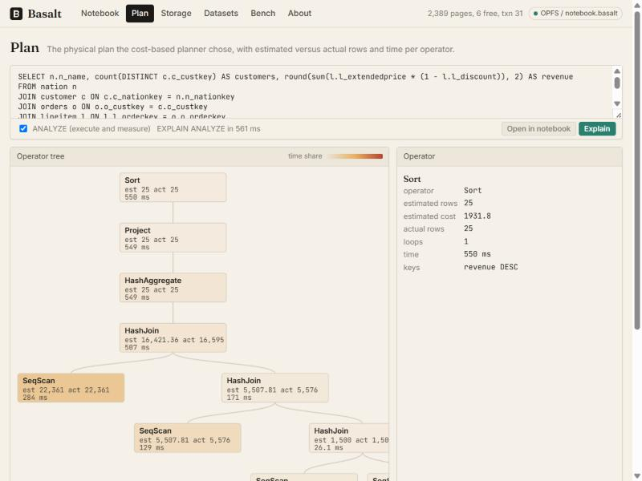
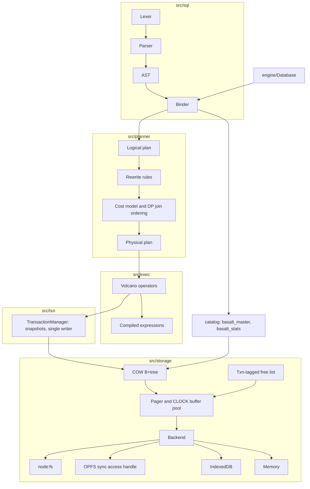

# Basalt

A relational database engine written from scratch in TypeScript with zero runtime dependencies. Pager, CLOCK buffer pool, copy-on-write B+tree, snapshot-isolation MVCC, SQL parser and binder, cost-based planner, Volcano executor. The same code runs in Node over a file and in the browser over the origin private file system (OPFS) inside a Web Worker.

**Try it:** https://rahultarigoppula.github.io/basalt-db/ (everything runs in your browser; nothing leaves the device)



## Features

Storage
- 4 KiB slotted pages (SQLite-style cell pointer array), 16-byte page header, overflow chains for values over 1000 bytes, keys up to 960 bytes.
- Copy-on-write B+tree with leaf and interior splits, merge and borrow on delete, root collapse, and cursors that hold the root-to-leaf path instead of sibling links (no stale pointers under copy-on-write).
- Pager with a fixed-capacity buffer pool (pin counts, CLOCK eviction, dirty write-through on eviction).
- Free list tagged with the committing transaction id: a page freed by transaction T is reused only when every live reader's snapshot is at or after T. The list is persisted in trunk pages and is itself copy-on-write.
- Double-buffered meta pages with CRC32: commit writes dirty pages, syncs, writes the other meta slot, syncs. A crash at any point leaves the previous meta page valid, so commits are atomic without a write-ahead log.
- Order-preserving key encoding: INTEGER and REAL share one numeric ordering domain, TEXT is CESU-8 so byte order equals JavaScript string order.

Transactions
- Snapshot isolation in the LMDB model: readers take the committed root and never block; writers are serialised.
- `BEGIN`, `COMMIT`, `ROLLBACK`, `SAVEPOINT`, `RELEASE`, `ROLLBACK TO`. Savepoints are copy-on-write epochs, not dirty-page copies.
- Statement-level atomicity inside explicit transactions.

SQL
- DDL: tables with `PRIMARY KEY`, `NOT NULL`, `UNIQUE`, `DEFAULT`, `CHECK`, composite keys; indexes (unique, partial); views; `ALTER TABLE RENAME TO` and `ADD COLUMN`.
- DML: multi-row `INSERT`, `INSERT ... SELECT`, `INSERT OR REPLACE`, upsert with `ON CONFLICT DO UPDATE`, `RETURNING`, `UPDATE`, `DELETE`.
- Queries: all join types including `FULL OUTER` and `NATURAL`, `GROUP BY` and `HAVING`, `ORDER BY ... NULLS FIRST|LAST`, `LIMIT OFFSET`, `UNION`, `INTERSECT`, `EXCEPT`, `WITH` and `WITH RECURSIVE`, scalar and correlated subqueries, `IN`, `EXISTS`, `CASE`, `CAST`, `BETWEEN`, `LIKE` and `GLOB` with `ESCAPE`, `VALUES` as a table.
- Window functions: `ROW_NUMBER`, `RANK`, `DENSE_RANK`, `NTILE`, `LAG`, `LEAD`, `FIRST_VALUE`, `LAST_VALUE`, and any aggregate over `PARTITION BY ... ORDER BY ... ROWS BETWEEN`.
- `EXPLAIN`, `EXPLAIN ANALYZE`, `ANALYZE`, `VACUUM`, `PRAGMA table_info`, `index_list`, `page_count`, `freelist_count`.

Planner
- Rewrite rules to a fixpoint: constant folding, predicate pushdown through projections and joins (outer-join aware), projection pruning, `EXISTS` and `IN (subquery)` to semi-join, uncorrelated scalar subqueries materialised once, `LIMIT` pushed into `ORDER BY` as top-k, outer-join simplification under null-rejecting predicates.
- Cost model fed by `ANALYZE` statistics (`basalt_stats`: row counts, distinct counts, null fractions, min/max, histograms) with sensible defaults when a table has not been analysed.
- Join ordering by dynamic programming over connected subsets for up to 8 relations, greedy beyond that.
- Physical choices: sequential scan versus index scan and index range scan (covering-index aware), nested-loop versus hash versus merge join, hash versus sorted aggregation, sort versus index-provided order, top-k heap for `ORDER BY ... LIMIT`.

Executor
- Volcano iterators: `open`, `next`, `close` with per-operator row counts and timings that feed `EXPLAIN ANALYZE`.
- Hash join for inner, left, right, full, semi and anti joins; merge join when both inputs arrive sorted; sort that spills to a temporary B+tree beyond a row threshold.
- Bound expressions compile to closures once per plan; no per-row AST walking. INTEGER is `bigint` end to end; results outside the safe integer range stay exact.

Testing
- sqllogictest-style suites, B+tree and pager unit tests with crash simulation, and differential fuzzing against SQLite through `node:sqlite`.

Browser
- OPFS persistence through `FileSystemSyncAccessHandle` in a Web Worker, IndexedDB fallback (load on open, flush after commit), memory fallback.
- A notebook, plan visualiser, storage inspector, bundled datasets and an in-browser benchmark (`web/`).

## Architecture



Lower layers never import upper layers. Everything above the backend is synchronous: OPFS provides synchronous reads and writes inside a worker, Node uses `fs.readSync` and `fs.writeSync`, and the IndexedDB backend loads the whole file at open and flushes dirty pages asynchronously after each commit. `docs/ARCHITECTURE.md` is the contract every module is built against; `docs/DESIGN-NOTES.md` explains the trade-offs (copy-on-write versus a WAL, why leaves carry no sibling links, savepoints as epochs).

## Life of a query

Take `SELECT c.c_name, sum(o.o_totalprice) FROM customer c JOIN orders o ON o.o_custkey = c.c_custkey WHERE o.o_orderdate >= '1996-01-01' GROUP BY c.c_custkey ORDER BY 2 DESC LIMIT 10`.

1. **Lex and parse** (`src/sql`): the hand-written recursive-descent parser produces an AST. Syntax errors carry a line and column.
2. **Bind** (`src/sql/binder`): names resolve against the catalog (`basalt_master` is parsed with the real parser at open time), column references become `(relation, index)` pairs, types are inferred, aggregates and window functions are hoisted out of expressions.
3. **Logical plan and rewrites** (`src/planner`): Scan, Join, Filter, Aggregate, Sort, Limit. The `o_orderdate` predicate is pushed below the join onto the `orders` scan; `ORDER BY ... LIMIT` becomes a TopK.
4. **Cost and physical choice**: statistics from `ANALYZE` estimate 5,508 of 7,500 orders pass the date filter. The DP join enumerator picks `customer` as the hash-join build side (1,500 rows) and `orders` as the probe. Because `o_orderdate` has an index but the range covers most of the table, the planner keeps a sequential scan with the filter applied inline.
5. **Execute** (`src/exec`): `TopK <- HashAggregate <- HashJoin(SeqScan customer, SeqScan orders + filter)`. Each operator records rows and milliseconds, which is what `EXPLAIN ANALYZE` and the Plan screen show (estimated versus actual rows per node).
6. **Storage**: scans walk B+tree leaves through the buffer pool under the transaction's snapshot root. A read-only statement never touches the free list or meta pages; a write statement copies each modified page to a fresh id, updates parents up to the root, and commits by writing the other meta slot.

## Usage

Node (22 or later):

```ts
import { Database } from "basalt-db";

const db = await Database.open({ file: "app.basalt" }); // or { memory: true }
db.exec(`
  CREATE TABLE users (id INTEGER PRIMARY KEY, name TEXT NOT NULL, created TEXT DEFAULT '2026-01-01');
  CREATE INDEX idx_users_name ON users(name);
`);
db.exec("INSERT INTO users (name) VALUES ('ada'), ('grace')");

const rows = db.query("SELECT id, name FROM users WHERE name = ?", ["ada"]).rows; // [[1n, "ada"]]
const stmt = db.prepare("INSERT INTO users (name) VALUES (:name)");
db.transaction(() => { stmt.run({ name: "linus" }); stmt.run({ name: "margaret" }); });

console.log(db.explain("SELECT * FROM users WHERE name = 'ada'", true)); // PlanNode tree with actual rows and ms
console.log(db.stats()); // { pageCount, freePages, cacheHits, cacheMisses, txnId }
await db.close();
```

Browser: open the database inside a Web Worker so OPFS can hand out a synchronous access handle.

```ts
// db.worker.ts
import { Database } from "basalt-db";
const db = await Database.open({ opfs: "app.basalt" }); // falls back: IndexedDbBackend.open(name), or { memory: true }
self.onmessage = (e) => {
  const { id, sql } = e.data;
  try { self.postMessage({ id, result: db.query(sql) }); }
  catch (err) { self.postMessage({ id, error: (err as Error).message }); }
};
```

```ts
// page
const worker = new Worker(new URL("./db.worker.ts", import.meta.url), { type: "module" });
worker.postMessage({ id: 1, sql: "SELECT 1 + 1" });
```

INTEGER values are `bigint` on both sides of the API; `Uint8Array` is BLOB; `number` is REAL. The reference worker protocol used by the web app lives in `web/src/worker/protocol.ts` and serialises `bigint` as tagged strings and blobs as hex.

Deep links: `https://rahultarigoppula.github.io/basalt-db/?q=SELECT%201` pre-fills the first notebook cell.

## SQL support

| Area | Supported | Not supported |
|---|---|---|
| Types | INTEGER (64-bit, exact), REAL, TEXT, BLOB, BOOLEAN, NULL with three-valued logic | Type affinity conversions on insert, DATE/TIME types (dates are TEXT) |
| DDL | CREATE TABLE (constraints, composite keys, defaults, CHECK), CREATE [UNIQUE] INDEX (partial), CREATE VIEW, DROP, ALTER TABLE RENAME TO / ADD COLUMN | Generated columns, expression indexes, triggers, foreign-key enforcement (clauses parse and are ignored) |
| DML | INSERT (multi-row, SELECT, OR REPLACE, ON CONFLICT DO UPDATE, RETURNING), UPDATE, DELETE | UPDATE ... FROM, MERGE |
| Joins | INNER, LEFT, RIGHT, FULL OUTER, CROSS, NATURAL, USING, comma joins, semi/anti via EXISTS and IN | LATERAL |
| Subqueries | Scalar, IN, EXISTS, correlated (re-evaluated per row when not decorrelated), derived tables | Correlated CTEs |
| Aggregation | COUNT, COUNT(DISTINCT), SUM, TOTAL, AVG, MIN, MAX, GROUP_CONCAT, HAVING | FILTER clause, user-defined aggregates |
| Windows | ROW_NUMBER, RANK, DENSE_RANK, NTILE, LAG, LEAD, FIRST_VALUE, LAST_VALUE, aggregates over frames (ROWS BETWEEN) | RANGE and GROUPS frames, named windows |
| Set operations | UNION, UNION ALL, INTERSECT, EXCEPT | |
| CTEs | WITH, WITH RECURSIVE (UNION and UNION ALL) | |
| Functions | length, upper, lower, substr, instr, replace, trim family, abs, round, floor, ceil, sqrt, pow, mod, min/max scalar, typeof, hex, random, printf/format, coalesce, nullif, iif | REGEXP, MATCH, date/time functions, JSON |
| Transactions | BEGIN, COMMIT, END, ROLLBACK, SAVEPOINT, RELEASE, ROLLBACK TO, snapshot isolation | Concurrent writers (writers are serialised) |
| Introspection | EXPLAIN, EXPLAIN ANALYZE, ANALYZE, VACUUM, PRAGMA table_info / index_list / page_count / freelist_count | |

Behavioural choices match SQLite where the differential fuzzer depends on it: integer division truncates, division by zero yields NULL, `upper`/`lower`/`LIKE` are ASCII-only, `COLLATE` parses as BINARY. Deliberate divergences found by the fuzzer are recorded in `docs/SQLITE-DIVERGENCES.md`.

## Testing

```
npx vitest run
Test Files  13 passed (13)
     Tests  1296 passed (1291)
```

- `tests/storage`: key encoding round trips and ordering; B+tree against a reference `Map` over 100,000 random inserts, deletes and gets with commits; variable-length keys up to the maximum; overflow values; pager crash simulation (discard unsynced writes, reopen, previous snapshot intact); free-list reuse; buffer-pool eviction under pin pressure; transaction visibility.
- `tests/sql`: lexer, parser, binder and expression evaluation (golden files).
- `tests/slt`: sqllogictest-style suites (`select`, `join`, `aggregate`, `window`, `cte`, `dml`) run by `runner.test.ts`.
- `scripts/fuzz.ts`: differential fuzzing against SQLite. Random schemas, data and SELECT queries from a grammar restricted to the shared subset, executed on both engines, sorted results compared. `npm run fuzz`.

## Benchmarks

In-browser numbers from the Bench screen (Chromium, OPFS backend, engine time only, median of 5 runs after one warm-up; 50,000-row `orders_50k` and TPC-H mini with 7,500 orders and 22,361 line items):

| query | rows | median ms |
|---|---:|---:|
| point lookup (rowid) | 1 | 0.19 |
| index equality (`customer_id = ?`) | 1 | 0.27 |
| index range (31 of 730 days) | 1 | 205 |
| seq scan + filter, 50k rows | 1 | 185 |
| group by, 25 groups | 25 | 281 |
| group by, 5,000 groups | 4,999 | 356 |
| order by + limit 10 (top-k) | 10 | 212 |
| full sort, 50k rows | 50,000 | 331 |
| hash join 1.5k x 7.5k | 5 | 17.3 |
| 3-way join + aggregate | 25 | 203 |
| window over 7.5k rows | 7,500 | 53.5 |
| recursive CTE, 10,000 steps | 1 | 4.87 |

Dataset generation: TPC-H mini (31,386 rows) in 2.7 s, 50,000 orders in 6.0 s, including index builds and `ANALYZE`. Node numbers from `npm run bench` go in `bench/RESULTS.md` once that script has been run on a reference machine.

## Limitations

- Single writer. Concurrent write transactions queue; there is no row-level locking.
- Sequential scans are evaluated row by row through compiled closures, so scan-heavy queries run at roughly 250,000 rows per second in the browser. There is no vectorised execution.
- The IndexedDB backend keeps the whole file in memory and flushes after commit, so a crash between commit and flush loses the last transaction. Use OPFS (the default in Chromium and Firefox) for durability.
- No foreign-key enforcement, triggers, generated columns, expression indexes, date/time functions or JSON functions.
- Keys are limited to 960 bytes; a single row value may be arbitrarily large through overflow pages, but a page holds at most four large cells.
- `VACUUM` rewrites the file through an in-memory image, which needs memory proportional to the live data.

## Roadmap

- Within-transaction page reuse: pages freed earlier in the same write transaction are currently not reused until commit, so one prepared `INSERT` per row inside a long transaction grows the file (multi-row `INSERT` avoids it; see the dataset loaders).
- Date and time functions, `FILTER` clauses, `RANGE` frames.
- Foreign-key enforcement and triggers.
- Vectorised scans and filter evaluation over leaf pages.
- A `.basalt` file import in the web app and a CSV importer.

## Privacy

The web app runs entirely in the browser. The database file is stored in the origin's private file system (or IndexedDB when OPFS is unavailable); there is no server, no analytics and no network request after the page loads. Reset database on the Notebook screen deletes the file.

## Licence

MIT. See `LICENSE`.
